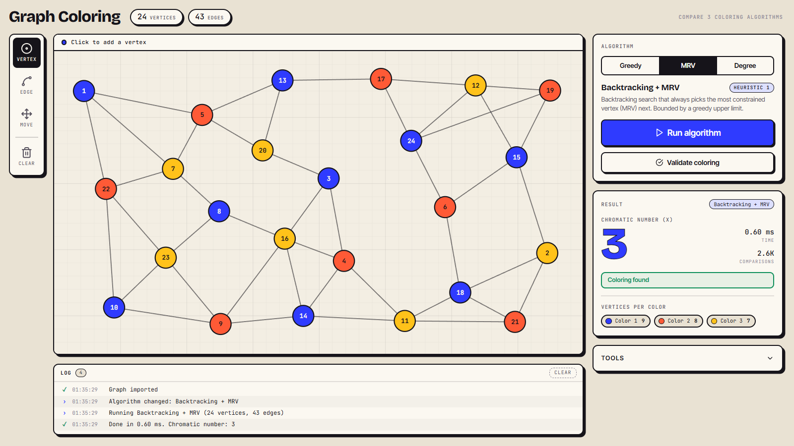
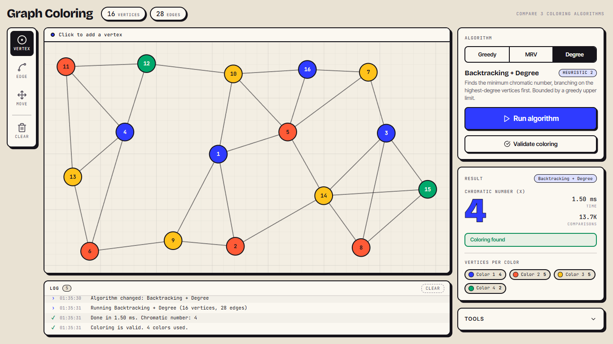
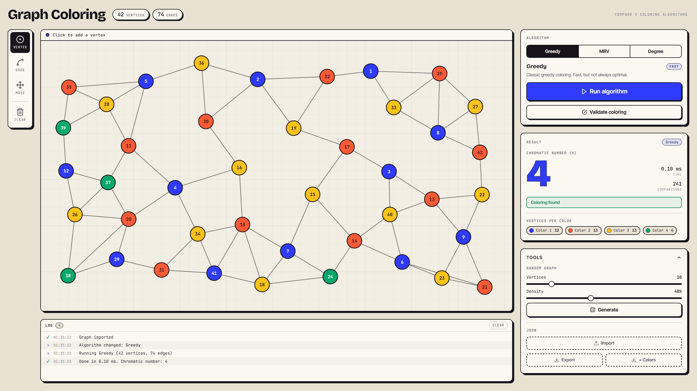

<h1 align="center">Graph Coloring</h1>

<p align="center">
  Build a graph on an interactive canvas and compare three graph coloring algorithms: a fast greedy pass and two backtracking searches with different heuristics.
  <br>
  <a href="https://graph-coloring-rouge.vercel.app/">Live demo</a>
</p>

<p align="center">
  
</p>

## Features

- Interactive SVG canvas: add vertices, connect them with edges, drag them around and delete with a double click.
- Three algorithms via the Strategy pattern: Greedy, Backtracking + MRV, Backtracking + Degree.
- Random graph generation with a configurable number of vertices and edge density.
- Heavy computations run in a Web Worker, so the interface never freezes.
- Result card with the chromatic number, execution time, comparison counter and the number of vertices per color.
- Built-in conflict validation and a timestamped log of every action.
- JSON import and export of the graph, with or without the coloring.
- The canvas follows the window: the layout and the graph scale from small laptops up to large monitors. Built for mouse input; touch dragging is not supported.

<table>
  <tr>
    <td align="center">
      
    </td>
    <td align="center">
      
    </td>
  </tr>
</table>

## Stack

- **App:** React 19, TypeScript, Vite, SCSS Modules, SVG, Web Workers
- **Algorithms:** pure TypeScript, no libraries (`src/services/algorithms`, one class per algorithm behind a common `IColoringStrategy` interface)

## Quick start

Requires Node.js 20.19+.

```bash
git clone https://github.com/Trothing/graph-coloring.git
cd graph-coloring
npm install
npm run dev
```

The app runs at `http://localhost:5173`.

```bash
npm run build     # type check and production build
npm run lint      # ESLint
```
